<div align="center">

<p align="center">
  
</p>

# Awesome Digital Content Provenance 🛡️✨

<p align="center">
  <a href="https://github.com/ishandutta2007/Awesome-Awesome-Awesome"></a><a href="https://discord.gg/jc4xtF58Ve"></a><a href="https://github.com/ishandutta2007/Awesome-Awesome-Awesome"></a><a href="https://github.com/ishandutta2007/Awesome-Digital-Content-Provenance/stargazers"></a><a href="https://github.com/ishandutta2007/Awesome-Digital-Content-Provenance/network/members"></a><a href="https://github.com/ishandutta2007/Awesome-Digital-Content-Provenance/blob/main/LICENSE"></a><a href="https://github.com/ishandutta2007"></a>
</p>

<p align="center">
  <strong>An authoritative curated list of enterprise SaaS platforms, APIs, and open-source developer tooling for Digital Content Provenance, C2PA Content Credentials, Synthetic Media Forensics, and Invisible Watermarking.</strong>
</p>

</div>

---

## 📌 Table of Contents

- [🌐 Overview](#-overview)
- [📊 Sector Overview & Market Dynamics](#-sector-overview--market-dynamics)
- [🏢 SaaS & Hosted Platforms](#-saas--hosted-platforms)
- [💻 Open-Source GitHub Projects](#-open-source-github-projects)
- [🏗️ Architecture & Implementation Blueprint](#️-architecture--implementation-blueprint)
- [📈 Star History](#--star-history)
- [🤝 How to Contribute](#-how-to-contribute)
- [💖 Support](#-support)
- [⚖️ Disclaimer](#️-disclaimer)

---

## 🌐 Overview

In the era of generative AI, deepfakes, and automated media generation, establishing verifiable origin, edit lineage, and authenticity has become foundational to information integrity. Digital content provenance provides technical frameworks to cryptographically bind creator metadata, capture signatures, and editing histories directly into media assets.

### 🔑 Key Pillars
- **C2PA Standard & Manifests 📜**: Technical standards governed by the [Coalition for Content Provenance and Authenticity](https://c2pa.org/) for tamper-evident metadata binding.
- **Content Credentials 🏷️**: Visual identifiers and cryptographic assertions championed by the [Content Authenticity Initiative (CAI)](https://contentauthenticity.org/).
- **Deepfake & Forgery Detection 🔍**: Multi-modal machine learning pipelines designed to identify manipulated speech, synthetic faces, and diffusion-generated imagery.
- **Resilient Watermarking 💧**: Inaudible and invisible neural watermarks linking media back to provenance registries despite cropping or compression.

---

## 📊 Sector Overview & Market Dynamics

The digital content provenance and deepfake detection sector is currently valued at approximately **$4.6 billion to $5.5 billion** across combined media integrity, authentication, and synthetic media defense markets, and is projected to expand past **$25 billion to $32 billion by 2035** at a CAGR exceeding **25%–34%**. The market remains **highly to moderately fragmented**, characterized by specialized AI detection startups, biometric cybersecurity providers, decentralized provenance ledgers, and enterprise creative suites (led by Adobe) competing across divergent deployment modalities rather than a single winner-take-all monopoly.

---

## 🏢 SaaS & Hosted Platforms

*Below is a comprehensive breakdown of commercial SaaS platforms and enterprise detection APIs, sorted in descending order by company valuation / market size.*

| Product / Company | Company Size (Valuation / Revenue) | Primary Focus | Pricing Tier | Free Tier / Trial Limits | Website |
| :--- | :--- | :--- | :--- | :--- | :--- |
| **[Adobe Content Authenticity / Content Credentials](https://contentauthenticity.org/)** | **~$102 Billion** Market Cap (~$23.8B Annual Rev) | C2PA creation, manifest signing, and identity binding across Creative Cloud | Starts at **$9.99/mo** (Single App / Creative Cloud Express Plan) | **Free Forever**: Public web inspect tool & Chrome extension are 100% free with unlimited inspects; free in Firefly (25 free generative credits/mo) | [contentauthenticity.org](https://contentauthenticity.org/) |
| **[Hive AI](https://thehive.ai/)** | **~$2.0 Billion – $3.5 Billion** Valuation (~$121M Raised) | Cloud APIs for AI-generated media classification, deepfake detection, and moderation | Starts at **$6.00 / 1,000 image requests** (~$6 / 1k video frames; ~$10 / audio hr) | **Free Trial**: Includes **$5.00 free API usage credit** for 14 days upon developer account registration | [thehive.ai](https://thehive.ai/) |
| **[Reality Defender](https://www.realitydefender.com/)** | **~$150 Million – $250 Million** Valuation (~$50M+ Raised) | Multi-modal enterprise deepfake detection across audio, video, images, and text | Starts at **$399.00/month** (Business Plan, billed annually for ~1,000 scans/mo) | **Free Trial**: **14-day trial period** with a limit of **50 free scans** for verified business/developer accounts | [realitydefender.com](https://www.realitydefender.com/) |
| **[Truepic](https://truepic.com/)** | **~$120 Million – $200 Million** Valuation (~$35M Raised) | Hardware-secured media capture, camera provenance, and visual inspection | Starts at **$1,000.00/month** (Truepic Vision base volume inspection tier) | **Free Trial**: **30-day proof-of-concept trial** with a limit of **25 test inspections** (no self-serve free-forever tier) | [truepic.com](https://truepic.com/) |
| **[Attestiv](https://attestiv.com/)** | **~$20 Million – $50 Million** Valuation (~$5M Raised) | Document & visual fraud prevention with forensic tamper detection for insurance/BFSI | Starts at **$250.00/month** (Entry DeepScan platform API package) | **Free Trial**: **14-day sandbox access** with up to **100 document/media validation calls** | [attestiv.com](https://attestiv.com/) |
| **[Optic (AI or Not)](https://optic.xyz/)** | **~$15 Million – $35 Million** Valuation (~$11M Raised) | AI-generated audio/image detection and synthetic media origin verification | Starts at **$19.00/month** (AI or Not Starter Web/API subscription) | **Free Forever**: Free web scanner tier limited to **5 checks per day** per IP without registration | [optic.xyz](https://optic.xyz/) |
| **[Numbers Protocol](https://www.numbersprotocol.io/)** | **~$12 Million – $25 Million** Market Cap / Valuation | Decentralized media provenance network and blockchain asset verification | Starts at **$0.01 per capture transaction** (or ~$49.00/mo Developer Pro Plan) | **Free Forever**: Developer Sandbox plan provides **100 free API commit transactions per month** | [numbersprotocol.io](https://www.numbersprotocol.io/) |
| **[Sensity AI](https://sensity.ai/)** | **~$10 Million – $25 Million** Valuation (~$4.5M Raised) | Real-time deepfake monitoring, facial manipulation detection, and threat intelligence | Starts at **$29.00/month** (Starter Detection API subscription) | **Free Trial**: **7-day test sandbox** with a cap of **20 API media analyses** | [sensity.ai](https://sensity.ai/) |
| **[GetReal Security](https://www.getrealsecurity.com/)** | **~$5 Million – $15 Million** Valuation (Seed stage) | Enterprise synthetic media forensics and media manipulation defense | Starts at **$150.00/month** (Developer & investigator security tier) | **Free Trial**: **14-day evaluation license** with a limit of **30 forensic image/audio analyses** | [getrealsecurity.com](https://www.getrealsecurity.com/) |
| **[C2PA Verify](https://contentcredentials.org/verify)** | **Non-Profit / Standards Consortium** (C2PA / Linux Foundation) | Official web reference verifier for Content Credentials manifests | **$0.00** (Free reference utility provided by C2PA ecosystem) | **Free Forever**: **Unlimited public inspections** for C2PA manifest verification | [contentcredentials.org/verify](https://contentcredentials.org/verify) |

---

## 💻 Open-Source GitHub Projects

*The following open-source frameworks, C2PA reference libraries, and deepfake detection engines are sorted in descending order by GitHub stargazers count.*

| Repository / Tool | Stars Badge | Language / Core Tech | Description | Stargazers Link |
| :--- | :---: | :--- | :--- | :--- |
| **[invisible-watermark](https://github.com/ShieldMnt/invisible-watermark)** | [](https://github.com/ShieldMnt/invisible-watermark/stargazers) | Python | Industry-standard invisible image watermarking library implementing DWT, DCT, and RivaGAN (used by Stable Diffusion to embed provenance signals). | [1,990+ Stargazers](https://github.com/ShieldMnt/invisible-watermark/stargazers) |
| **[DeepfakeBench](https://github.com/SCLBD/DeepfakeBench)** | [](https://github.com/SCLBD/DeepfakeBench/stargazers) | Python / PyTorch | Comprehensive benchmark platform and evaluation framework providing unified implementations of 15+ deepfake detection algorithms. | [1,135+ Stargazers](https://github.com/SCLBD/DeepfakeBench/stargazers) |
| **[dfdc_deepfake_challenge](https://github.com/selimsef/dfdc_deepfake_challenge)** | [](https://github.com/selimsef/dfdc_deepfake_challenge/stargazers) | Python / PyTorch | 1st place solution for the Kaggle Deepfake Detection Challenge using EfficientNet and MTCNN face-tracking pipelines. | [867+ Stargazers](https://github.com/selimsef/dfdc_deepfake_challenge/stargazers) |
| **[Awesome-Face-Forgery-Detection](https://github.com/clpeng/Awesome-Face-Forgery-Generation-and-Detection)** | [](https://github.com/clpeng/Awesome-Face-Forgery-Generation-and-Detection/stargazers) | Markdown / Research | Comprehensive repository cataloging state-of-the-art research papers, datasets, and benchmarks for facial manipulation detection. | [782+ Stargazers](https://github.com/clpeng/Awesome-Face-Forgery-Generation-and-Detection/stargazers) |
| **[c2pa-rs](https://github.com/contentauth/c2pa-rs)** | [](https://github.com/contentauth/c2pa-rs/stargazers) | Rust | Official C2PA reference implementation. High-performance engine for reading, validating, and generating Content Credentials manifests. | [437+ Stargazers](https://github.com/contentauth/c2pa-rs/stargazers) |
| **[c2pa-specifications](https://github.com/c2pa-org/specifications)** | [](https://github.com/c2pa-org/specifications/stargazers) | HTML / Schemas | Official repository holding the published C2PA technical specifications, manifest schemas, and architecture definitions. | [212+ Stargazers](https://github.com/c2pa-org/specifications/stargazers) |
| **[trustmark](https://github.com/adobe/trustmark)** | [](https://github.com/adobe/trustmark/stargazers) | Python | Adobe's open-source durable watermarking architecture enabling soft-binding of C2PA manifests to withstand compression and screenshots. | [172+ Stargazers](https://github.com/adobe/trustmark/stargazers) |
| **[c2patool](https://github.com/contentauth/c2patool)** | [](https://github.com/contentauth/c2patool/stargazers) | Rust / CLI | Official command-line utility for reading, validating, generating, and embedding C2PA manifests into media files in automated CI/CD workflows. | [156+ Stargazers](https://github.com/contentauth/c2patool/stargazers) |
| **[c2pa-python](https://github.com/contentauth/c2pa-python)** | [](https://github.com/contentauth/c2pa-python/stargazers) | Python / PyO3 | Official Python bindings for `c2pa-rs`, bringing Content Credentials signing and verification directly into Python web and data workflows. | [109+ Stargazers](https://github.com/contentauth/c2pa-python/stargazers) |
| **[c2pa-public-draft](https://github.com/c2pa-org/public-draft)** | [](https://github.com/c2pa-org/public-draft/stargazers) | Markdown / Docs | Public drafts, community RFCs, and upcoming standard revisions for the C2PA specification. | [43+ Stargazers](https://github.com/c2pa-org/public-draft/stargazers) |
| **[c2pa-js](https://github.com/contentauth/c2pa-js)** | [](https://github.com/contentauth/c2pa-js/stargazers) | TypeScript / WASM | Official JavaScript/TypeScript SDK for reading, displaying, and interacting with C2PA manifests client-side in browsers and Node.js. | [40+ Stargazers](https://github.com/contentauth/c2pa-js/stargazers) |
| **[c2pa-swift](https://github.com/contentauth/c2pa-swift)** | [](https://github.com/contentauth/c2pa-swift/stargazers) | Swift | Official Swift SDK and iOS bindings for embedding C2PA manifest verification and signing into iOS and macOS applications. | [27+ Stargazers](https://github.com/contentauth/c2pa-swift/stargazers) |
| **[capture-lite](https://github.com/numbersprotocol/capture-lite)** | [](https://github.com/numbersprotocol/capture-lite/stargazers) | TypeScript / React Native | Open-source mobile application for verifiable photo and video capture with decentralized provenance anchoring. | [26+ Stargazers](https://github.com/numbersprotocol/capture-lite/stargazers) |
| **[c2pa-cpp](https://github.com/contentauth/c2pa-cpp)** | [](https://github.com/contentauth/c2pa-cpp/stargazers) | C++ | Official C++ bindings around `c2pa-rs` engineered for native desktop applications, camera firmware, and embedded devices. | [17+ Stargazers](https://github.com/contentauth/c2pa-cpp/stargazers) |
| **[c2pa-android](https://github.com/contentauth/c2pa-android)** | [](https://github.com/contentauth/c2pa-android/stargazers) | Kotlin / Android | Official Android library facilitating Content Credentials verification and manifest generation on Android mobile devices. | [13+ Stargazers](https://github.com/contentauth/c2pa-android/stargazers) |
| **[c2pa-service-example](https://github.com/contentauth/c2pa-service-example)** | [](https://github.com/contentauth/c2pa-service-example/stargazers) | Rust / Docker | Reference microservice demonstrating how to deploy a scalable, containerized C2PA signing service in production clouds. | [12+ Stargazers](https://github.com/contentauth/c2pa-service-example/stargazers) |
| **[watermark](https://github.com/kylosarc/watermark)** | [](https://github.com/kylosarc/watermark/stargazers) | TypeScript / React | Local-first browser-based forensic inspection workbench for extracting C2PA manifests, metadata, and neural watermarks offline. | [1+ Stargazers](https://github.com/kylosarc/watermark/stargazers) |

---

## 🏗️ Architecture & Implementation Blueprint

```
[ Origin / Capture ] 📸
   │  ↳ Hardware attestation (Truepic SDK, camera-level signed manifests)
   ▼
[ Manifest Authoring & Signing ] 🔐
   │  ↳ Cryptographic assertions via c2pa-rs / c2patool with X.509 PKI certificates
   ▼
[ Durable Watermark Binding ] 💧
   │  ↳ Embed resilient soft-bindings via TrustMark or invisible-watermark
   ▼
[ Distribution & Storage ] 🌐
   │  ↳ Embed manifests directly into JPEGs/PNGs/MP4s or anchor on Numbers Protocol
   ▼
[ Ingestion & Forensics ] 🛡️
   │  ↳ In-browser verification with c2pa-js / provcheck
   │  ↳ Deepfake & forgery classification via Reality Defender / Hive AI / DeepfakeBench
```

---

## 📈 Star History

[](https://star-history.dera.page/#ishandutta2007/Awesome-Digital-Content-Provenance&type=date&legend=top-left)

---

## 🤝 How to Contribute

Contributions make the open-source and content provenance ecosystem flourish! 🌟

1. **Fork the Repository** 🍴
2. **Create a Feature Branch** (`git checkout -b feature/add-new-provenance-tool`)
3. **Add Your Entry**: Ensure SaaS entries include specific starting prices, exact free trial / free tier limits, and valuation/company size. For open-source tools, include the GitHub repository and social star badge.
4. **Follow Formatting Guidelines**: Ensure markdown tables remain consistent and all links are functional.
5. **Open a Pull Request** 🚀

---

## 💖 Support

If you found this curated directory useful for your research, team, or application development, please consider showing your support:

- 🌟 **Star this repository** on GitHub!
- 🍴 **Fork it** and contribute new tools or updates.
- 📢 **Share it** with friends, colleagues, and on social media!
- ☕ **Buy me a coffee / Sponsor on GitHub**: [Sponsor Dashboard https://github.com/sponsors/ishandutta2007](https://github.com/sponsors/ishandutta2007)

Thank you for helping keep digital media transparent, authentic, and verifiable! 🙏❤️

---

## ⚖️ Disclaimer

This repository is an independent community-curated reference directory for informational and educational purposes. Inclusion does not represent an endorsement. Authenticity verification mechanisms, watermarks, and AI deepfake detection models are probabilistic security controls with operational boundaries; always combine automated tools with human contextual analysis and defense-in-depth principles.
